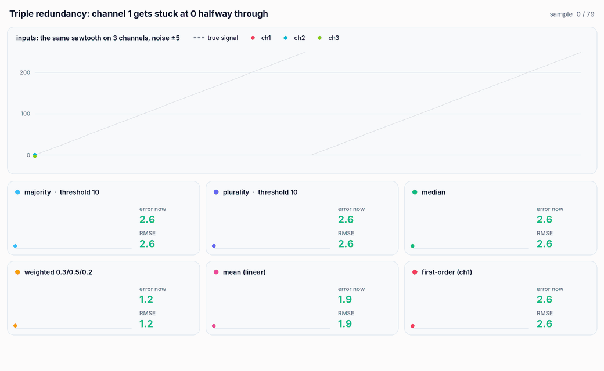
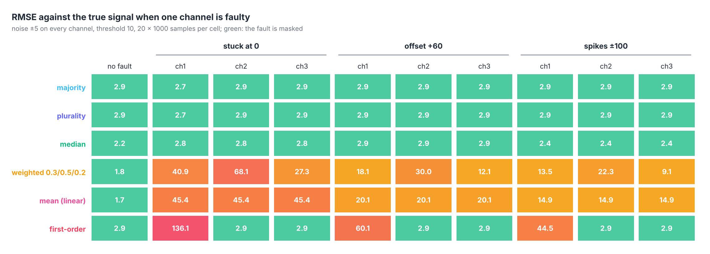
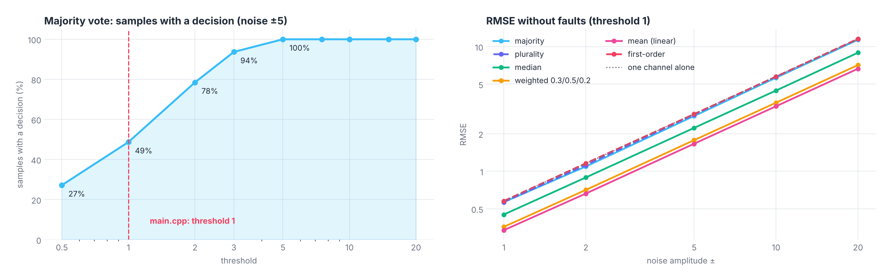

<p align="right">
  <a href="README.md"> <b>English</b></a>
  &nbsp;|&nbsp;
  <a href="README.pl.md"> Polski</a>
</p>

<a href="#see-it-in-action">
  <picture>
    <source media="(prefers-color-scheme: dark)" srcset="docs/banner-en-dark.svg" />
    <source media="(prefers-color-scheme: light)" srcset="docs/banner-en-light.svg" />
    
  </picture>
</a>

<p align="center">
  
  
  
  
  
</p>

<p align="center">
  <a href="#see-it-in-action"><b>Demo</b></a> &nbsp;·&nbsp;
  <a href="#how-it-works"><b>How it works</b></a> &nbsp;·&nbsp;
  <a href="#results"><b>Results</b></a> &nbsp;·&nbsp;
  <a href="#what-was-fixed"><b>Fixes</b></a> &nbsp;·&nbsp;
  <a href="#getting-started"><b>Getting started</b></a> &nbsp;·&nbsp;
  <a href="#project-structure"><b>Structure</b></a>
</p>

**Fault-Tolerant Voting Algorithms** is a team project for the *Reliability and Diagnostics of Digital Circuits* course (*Niezawodność i Diagnostyka Układów Cyfrowych*, part 2) at Wrocław University of Science and Technology. It models **triple modular redundancy**: the same signal comes from three channels, each with its own noise, and a **voter** has to turn the three readings into one value. The project implements six voters: inexact **majority** and **plurality** voting, **weighted average**, **median**, **mean** (linear voting) and **first-order** voting.

The program generates three noisy copies of a sawtooth signal, runs every voter on them and writes the inputs and all six outputs to CSV files. `tools/experiment` goes further: it compares every voter with the noise-free signal, sweeps the noise level and the grouping threshold, and injects faults into one channel.

## See it in action

<p align="center">
  <picture>
    <source media="(prefers-color-scheme: dark)" srcset="docs/en/voting-dark.gif" />
    <source media="(prefers-color-scheme: light)" srcset="docs/en/voting-light.gif" />
    
  </picture>
</p>

<p align="center"><sub>Real output of <code>experiment trace stuck 1</code> (saved in <code>results/trace_stuck_ch1.csv</code>): two periods of the sawtooth, 80 samples, noise ±5 on every channel, threshold 10 for majority and plurality. From sample 40 channel 1 is stuck at 0. Each card shows one voter against the true signal (dashed), the error of the current sample and the RMSE so far.</sub></p>

## Highlights

<table>
  <tr>
    <td width="25%" align="center"><h3>51%</h3><sub>of samples get no answer (-99) from<br/>majority voting with the original threshold 1</sub></td>
    <td width="25%" align="center"><h3>2.4 to 2.9</h3><sub>RMSE of the median with any single<br/>faulty channel: every fault is masked</sub></td>
    <td width="25%" align="center"><h3>68</h3><sub>RMSE of the weighted average when<br/>the channel with weight 0.5 gets stuck</sub></td>
    <td width="25%" align="center"><h3>1.7</h3><sub>RMSE of the mean without faults,<br/>against 2.9 for a single channel</sub></td>
  </tr>
</table>

- **Six voters behind one interface.** All of them take the three readings of one sample and return one value, so they can be swapped and compared on the same data.
- **Inexact voting.** Majority and plurality voting group readings that differ by at most a threshold, because analog readings almost never agree exactly.
- **Measured against the truth.** The experiment generates the same signal without noise and reports RMSE, maximum error and how often the voter gave an answer.
- **Fault injection.** One channel can be stuck at 0, shifted by +60 or hit by ±100 spikes in 20% of the samples, on any of the three channels.

## How it works

The signal is a sawtooth from 0 to 255 (an 8-bit range). `DataGenerator` samples it and adds uniform noise in ±`randomOffsetRange`. The demo in `main.cpp` uses 2 Hz, 1 second and 20 samples per second, so 20 samples and two periods, noise ±5 and threshold 1. Each channel gets independent noise; the seed comes from `std::random_device`, so every run is different.

| Voter | Function | What it returns |
|---|---|---|
| **Majority** (inexact) | `votingAlgorithm(v, threshold, true)` | groups readings within the threshold; if the largest group has more than half of the readings, its first reading, otherwise `NO_MAJORITY` (-99) |
| **Plurality** (inexact) | `votingAlgorithm(v, threshold, false)` | the first reading of the largest group, whatever its size |
| **Weighted average** | `weightedAverageVoting(v, {0.3, 0.5, 0.2})` | weighted mean; channel 2 counts the most |
| **Median** | `medianVoting(v)` | the middle reading |
| **Mean** (linear) | `linearVoting(v)` | arithmetic mean |
| **First-order** | `firstOrderVoting(v)` | the first reading, i.e. channel 1; no redundancy at all |

A reading joins the first group whose **first** reading is within the threshold, otherwise it starts a new group. A detailed walkthrough of the code in Polish is in [`docs/objasnienie.md`](docs/objasnienie.md).

## Results

All numbers come from `tools/experiment` (the full table is in `results/experiment.csv`): every point is 20 runs of 1 000 samples, errors are measured against the same sawtooth without noise.

<p align="center">
  <picture>
    <source media="(prefers-color-scheme: dark)" srcset="docs/en/faults-dark.png" />
    <source media="(prefers-color-scheme: light)" srcset="docs/en/faults-light.png" />
    
  </picture>
</p>

- **Median, majority and plurality mask every single fault.** Their RMSE stays between 2.4 and 2.9 whichever channel fails and however; without a fault they give 2.2 to 2.9.
- **Averaging spreads the fault over the output.** A channel stuck at 0 pulls the mean down by a third of the signal (RMSE 45) and the weighted average by its weight: 41, 68 and 27 for channels 1, 2 and 3. Spikes in 20% of the samples still give an RMSE of 9 to 22.
- **First-order voting is only as good as channel 1.** It is perfect when another channel fails and as bad as it gets when channel 1 does (RMSE 136 for stuck at 0).

<p align="center">
  <picture>
    <source media="(prefers-color-scheme: dark)" srcset="docs/en/noise-dark.png" />
    <source media="(prefers-color-scheme: light)" srcset="docs/en/noise-light.png" />
    
  </picture>
</p>

- **Threshold 1 is too small for noise ±5.** Two readings of the same value can differ by up to 10, so with threshold 1 majority voting finds no majority in **about half of the samples** (in the 20-sample demo about 10 of them return -99; between 6 and 14 in 40 runs). The answer rate is 78% at threshold 2 and 100% from threshold 5: three readings within a range of 10 always contain two that are at most 5 apart.
- **Majority and plurality do not reduce the noise.** They return the first reading of the winning group, not its mean, so their RMSE equals that of one channel (amplitude/√3, 2.9 for ±5). The median gives 2.2, the weighted average 1.8 and the mean 1.7, which is the √3 improvement expected from averaging three independent readings.
- **No voter wins everywhere.** The mean is the most accurate when all channels work and the worst choice when one fails; the median is a little noisier but masks every fault. Returning the mean of the winning group from majority voting would combine both.

The animation also shows a weak spot of grouping by the first reading: right after channel 1 gets stuck, its 0 is still within the threshold of the other channels near the bottom of the sawtooth, it is the first reading of the group, and majority voting returns it (errors of 6.4 and 12.8 in two samples).

## What was fixed

- **Plurality voting called majority voting.** The plurality block in `main.cpp` passed `true` as `czyWiekszosc`, so `pluralistyczne.csv` was byte-for-byte the same file as `wiekszosciowe.csv`. It now passes `false`.
- **CSV format.** Every cell was followed by `", "`, including the last one, so each line ended with a separator and every value after the first started with a space. Cells are now separated by a single comma.
- **The -99 constant.** The value meaning "no majority" is now `NO_MAJORITY` in `Voting.h`; the explanation in `docs/` said -1.
- **Structure.** The voters, the CSV writer and the signal generator moved out of `main.cpp` into packages; `main.cpp` runs the six voters in one loop instead of six copied blocks, and an unused test vector was removed. Otherwise the program prints and saves the same things as before.

## Getting started

<p align="center">
  
</p>

**CLion:** open the folder and run `voting` or `experiment`.

**Command line:**

```bash
cmake -S . -B build -DCMAKE_BUILD_TYPE=Release
cmake --build build
./build/voting                          # demo: prints the channels and six outputs, writes nine CSV files
./build/experiment                      # summary table (about 0.2 s)
./build/experiment csv > experiment.csv # full table: threshold, noise and fault scenarios
./build/experiment trace stuck 1        # sample-by-sample trace; faults: stuck / offset / spikes, channel 1 to 3
```

`voting` writes its files to the working directory: `data_1.csv` to `data_3.csv` (the channels, columns `lp,generated`) and `wiekszosciowe.csv`, `pluralistyczne.csv`, `weighted.csv`, `median.csv`, `linear.csv`, `first_order.csv` (columns `lp,selected`). The demo labels its output partly in Polish; `experiment` prints in English.

## Project structure

```
.
├── src/
│   ├── main.cpp            # demo: three channels, six voters, CSV output
│   ├── voting/             # Voting: the six voters and NO_MAJORITY
│   ├── signal/             # DataGenerator: noisy sawtooth
│   └── io/                 # CsvWriter
├── tools/experiment.cpp    # comparison with the true signal, noise and threshold sweeps, fault injection
├── results/                # experiment.csv (tables and charts), trace_stuck_ch1.csv (animation)
└── docs/                   # objasnienie.md (code walkthrough, Polish), README visuals (EN / PL, light / dark)
```

<details>
<summary><b>Notes on the code</b></summary>
<br/>

- Grouping compares a reading only with the **first** reading of each group, so the result can depend on the order of the channels: with threshold 1, readings 0, 0.9 and 1.8 form groups {0, 0.9} and {1.8}, while 1.8, 0.9, 0 form {1.8, 0.9} and {0}.
- -99 is a valid signal value (the signal is noisy), so `NO_MAJORITY` can in principle be confused with a real reading. `std::optional<double>` would avoid that.
- The voters work for any number of channels; only the weights {0.3, 0.5, 0.2} assume three.
- The generator seeds a new `std::mt19937` from `std::random_device` on every call, so runs cannot be repeated with a fixed seed. The experiment results therefore differ from run to run in the second decimal place.

</details>

---

<p align="center">
  <sub>Wrocław University of Science and Technology · Reliability and Diagnostics of Digital Circuits · Grzegorz Sienkiewicz, Filip Zmyślony, Kamil Sromek</sub>
</p>
