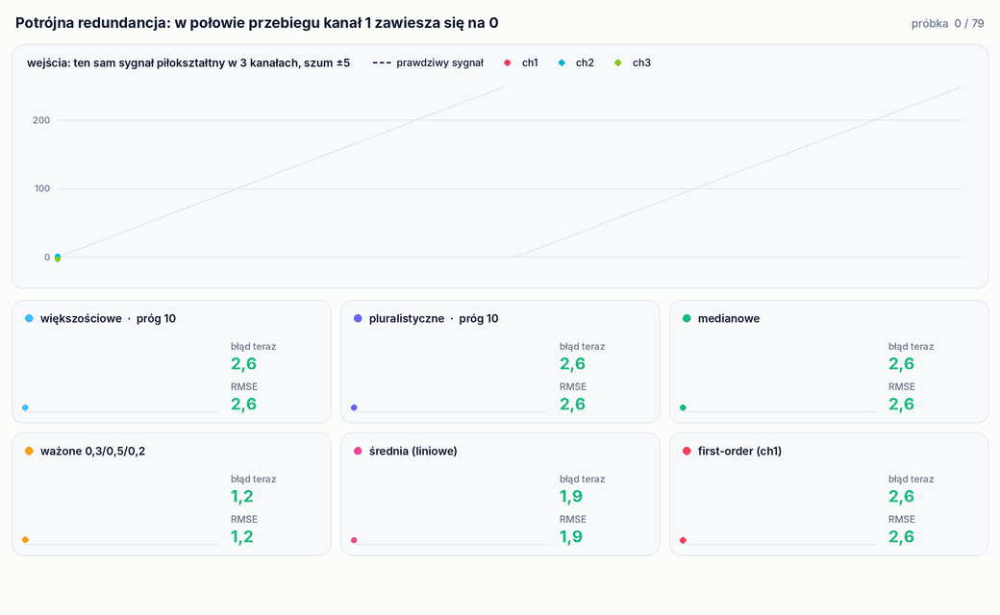
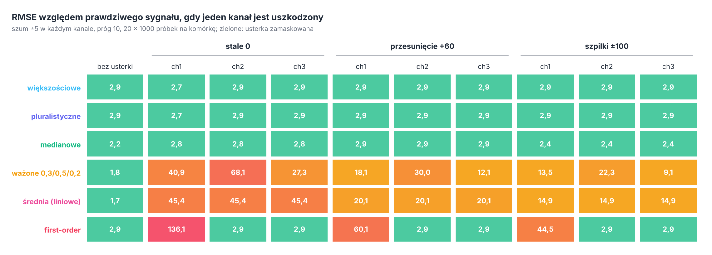
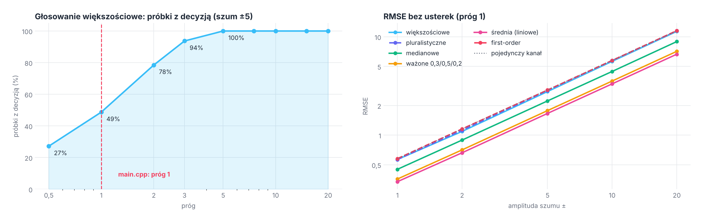

<p align="right">
  <a href="README.md"> English</a>
  &nbsp;|&nbsp;
  <a href="README.pl.md"> <b>Polski</b></a>
</p>

<a href="#zobacz-jak-działa">
  <picture>
    <source media="(prefers-color-scheme: dark)" srcset="docs/banner-pl-dark.svg" />
    <source media="(prefers-color-scheme: light)" srcset="docs/banner-pl-light.svg" />
    
  </picture>
</a>

<p align="center">
  
  
  
  
  
</p>

<p align="center">
  <a href="#zobacz-jak-działa"><b>Demo</b></a> &nbsp;·&nbsp;
  <a href="#jak-to-działa"><b>Jak to działa</b></a> &nbsp;·&nbsp;
  <a href="#wyniki"><b>Wyniki</b></a> &nbsp;·&nbsp;
  <a href="#co-zostało-poprawione"><b>Poprawki</b></a> &nbsp;·&nbsp;
  <a href="#uruchomienie"><b>Uruchomienie</b></a> &nbsp;·&nbsp;
  <a href="#struktura-projektu"><b>Struktura</b></a>
</p>

**Fault-Tolerant Voting Algorithms** to projekt zespołowy z kursu *Niezawodność i Diagnostyka Układów Cyfrowych* (część 2) na Politechnice Wrocławskiej. Modeluje **potrójną redundancję modułową** (TMR): ten sam sygnał przychodzi z trzech kanałów, każdy z własnym szumem, a **układ głosujący** musi z trzech odczytów zrobić jedną wartość. Projekt zawiera sześć metod głosowania: nieprecyzyjne głosowanie **większościowe** i **pluralistyczne**, **średnią ważoną**, **medianę**, **średnią** (głosowanie liniowe) i głosowanie **first-order**.

Program generuje trzy zaszumione kopie sygnału piłokształtnego, uruchamia na nich każdą metodę i zapisuje wejścia oraz wszystkie sześć wyników do plików CSV. `tools/experiment` idzie dalej: porównuje każdą metodę z sygnałem bez szumu, zmienia poziom szumu i próg grupowania oraz wstrzykuje usterki do jednego kanału.

## Zobacz, jak działa

<p align="center">
  <picture>
    <source media="(prefers-color-scheme: dark)" srcset="docs/pl/voting-dark.gif" />
    <source media="(prefers-color-scheme: light)" srcset="docs/pl/voting-light.gif" />
    
  </picture>
</p>

<p align="center"><sub>Prawdziwe wyjście <code>experiment trace stuck 1</code> (zapisane w <code>results/trace_stuck_ch1.csv</code>): dwa okresy sygnału, 80 próbek, szum ±5 w każdym kanale, próg 10 dla głosowania większościowego i pluralistycznego. Od próbki 40 kanał 1 jest stale równy 0. Każda karta pokazuje jedną metodę na tle prawdziwego sygnału (linia przerywana), błąd bieżącej próbki i dotychczasowe RMSE.</sub></p>

## Najważniejsze

<table>
  <tr>
    <td width="25%" align="center"><h3>51%</h3><sub>próbek bez odpowiedzi (-99) w głosowaniu<br/>większościowym z oryginalnym progiem 1</sub></td>
    <td width="25%" align="center"><h3>2,4 do 2,9</h3><sub>RMSE mediany przy dowolnym jednym<br/>uszkodzonym kanale: każda usterka zamaskowana</sub></td>
    <td width="25%" align="center"><h3>68</h3><sub>RMSE średniej ważonej, gdy zawiesi się<br/>kanał z wagą 0,5</sub></td>
    <td width="25%" align="center"><h3>1,7</h3><sub>RMSE średniej bez usterek,<br/>wobec 2,9 dla pojedynczego kanału</sub></td>
  </tr>
</table>

- **Sześć metod z jednym interfejsem.** Każda dostaje trzy odczyty jednej próbki i zwraca jedną wartość, więc można je wymieniać i porównywać na tych samych danych.
- **Głosowanie nieprecyzyjne.** Głosowanie większościowe i pluralistyczne grupuje odczyty różniące się co najwyżej o próg, bo odczyty analogowe prawie nigdy nie są dokładnie równe.
- **Pomiar względem prawdy.** Eksperyment generuje ten sam sygnał bez szumu i podaje RMSE, błąd maksymalny oraz jak często metoda dała odpowiedź.
- **Wstrzykiwanie usterek.** Jeden kanał może być stale równy 0, przesunięty o +60 albo dostawać szpilki ±100 w 20% próbek, w dowolnym z trzech kanałów.

## Jak to działa

Sygnał to piła od 0 do 255 (zakres 8-bitowy). `DataGenerator` próbkuje ją i dodaje szum jednostajny z przedziału ±`randomOffsetRange`. Demo w `main.cpp` używa 2 Hz, 1 sekundy i 20 próbek na sekundę, czyli 20 próbek i dwóch okresów, szumu ±5 i progu 1. Każdy kanał ma niezależny szum; ziarno pochodzi z `std::random_device`, więc każde uruchomienie jest inne.

| Metoda | Funkcja | Co zwraca |
|---|---|---|
| **Większościowe** (nieprecyzyjne) | `votingAlgorithm(v, prog, true)` | grupuje odczyty w granicach progu; jeśli największa grupa ma ponad połowę odczytów, jej pierwszy odczyt, w przeciwnym razie `NO_MAJORITY` (-99) |
| **Pluralistyczne** (nieprecyzyjne) | `votingAlgorithm(v, prog, false)` | pierwszy odczyt największej grupy, niezależnie od jej rozmiaru |
| **Średnia ważona** | `weightedAverageVoting(v, {0.3, 0.5, 0.2})` | średnia ważona; kanał 2 liczy się najbardziej |
| **Mediana** | `medianVoting(v)` | środkowy odczyt |
| **Średnia** (liniowe) | `linearVoting(v)` | średnia arytmetyczna |
| **First-order** | `firstOrderVoting(v)` | pierwszy odczyt, czyli kanał 1; bez żadnej redundancji |

Odczyt trafia do pierwszej grupy, której **pierwszy** odczyt mieści się w progu, w przeciwnym razie zakłada nową grupę. Szczegółowe omówienie kodu jest w [`docs/objasnienie.md`](docs/objasnienie.md).

## Wyniki

Wszystkie liczby pochodzą z `tools/experiment` (pełna tabela jest w `results/experiment.csv`): każdy punkt to 20 przebiegów po 1 000 próbek, błędy liczone względem tego samego sygnału bez szumu.

<p align="center">
  <picture>
    <source media="(prefers-color-scheme: dark)" srcset="docs/pl/faults-dark.png" />
    <source media="(prefers-color-scheme: light)" srcset="docs/pl/faults-light.png" />
    
  </picture>
</p>

- **Mediana, głosowanie większościowe i pluralistyczne maskują każdą pojedynczą usterkę.** Ich RMSE zostaje między 2,4 a 2,9 niezależnie od tego, który kanał i jak się psuje; bez usterki dają 2,2 do 2,9.
- **Uśrednianie rozkłada usterkę na wynik.** Kanał stale równy 0 obniża średnią o jedną trzecią sygnału (RMSE 45), a średnią ważoną o swoją wagę: 41, 68 i 27 dla kanałów 1, 2 i 3. Szpilki w 20% próbek nadal dają RMSE od 9 do 22.
- **Głosowanie first-order jest dokładnie tak dobre jak kanał 1.** Jest idealne, gdy psuje się inny kanał, i najgorsze z możliwych, gdy psuje się kanał 1 (RMSE 136 przy stałym 0).

<p align="center">
  <picture>
    <source media="(prefers-color-scheme: dark)" srcset="docs/pl/noise-dark.png" />
    <source media="(prefers-color-scheme: light)" srcset="docs/pl/noise-light.png" />
    
  </picture>
</p>

- **Próg 1 jest za mały dla szumu ±5.** Dwa odczyty tej samej wartości mogą różnić się nawet o 10, więc przy progu 1 głosowanie większościowe nie znajduje większości w **mniej więcej połowie próbek** (w 20-próbkowym demo około 10 z nich zwraca -99; od 6 do 14 w 40 uruchomieniach). Odsetek odpowiedzi wynosi 78% przy progu 2 i 100% od progu 5: wśród trzech odczytów w przedziale o szerokości 10 zawsze są dwa oddalone o co najwyżej 5.
- **Głosowanie większościowe i pluralistyczne nie zmniejsza szumu.** Zwraca pierwszy odczyt zwycięskiej grupy, a nie jej średnią, więc RMSE jest takie jak dla jednego kanału (amplituda/√3, czyli 2,9 dla ±5). Mediana daje 2,2, średnia ważona 1,8, a średnia 1,7, czyli poprawę √3, jakiej można się spodziewać po uśrednieniu trzech niezależnych odczytów.
- **Żadna metoda nie wygrywa wszędzie.** Średnia jest najdokładniejsza, gdy wszystkie kanały działają, i najgorszym wyborem, gdy jeden się psuje; mediana jest trochę bardziej zaszumiona, ale maskuje każdą usterkę. Zwracanie średniej ze zwycięskiej grupy w głosowaniu większościowym połączyłoby obie zalety.

Animacja pokazuje też słaby punkt grupowania według pierwszego odczytu: tuż po zawieszeniu się kanału 1 jego 0 mieści się jeszcze w progu względem pozostałych kanałów przy dole piły, jest pierwszym odczytem grupy i głosowanie większościowe je zwraca (błędy 6,4 i 12,8 w dwóch próbkach).

## Co zostało poprawione

- **Głosowanie pluralistyczne wywoływało większościowe.** Blok pluralistyczny w `main.cpp` przekazywał `true` jako `czyWiekszosc`, więc `pluralistyczne.csv` był bajt w bajt tym samym plikiem co `wiekszosciowe.csv`. Teraz przekazuje `false`.
- **Format CSV.** Po każdej komórce był zapisywany `", "`, także po ostatniej, więc każdy wiersz kończył się separatorem, a każda wartość po pierwszej zaczynała się od spacji. Teraz komórki rozdziela jeden przecinek.
- **Stała -99.** Wartość oznaczająca brak większości to teraz `NO_MAJORITY` w `Voting.h`; objaśnienie w `docs/` podawało -1.
- **Struktura.** Metody głosowania, zapis CSV i generator sygnału zostały wydzielone z `main.cpp` do pakietów; `main.cpp` uruchamia sześć metod w jednej pętli zamiast sześciu skopiowanych bloków, a nieużywany wektor testowy został usunięty. Poza tym program wypisuje i zapisuje to samo co wcześniej.

## Uruchomienie

<p align="center">
  
</p>

**CLion:** otwórz folder i uruchom `voting` albo `experiment`.

**Wiersz poleceń:**

```bash
cmake -S . -B build -DCMAKE_BUILD_TYPE=Release
cmake --build build
./build/voting                          # demo: wypisuje kanały i sześć wyników, zapisuje dziewięć plików CSV
./build/experiment                      # tabela podsumowania (około 0,2 s)
./build/experiment csv > experiment.csv # pełna tabela: scenariusze progu, szumu i usterek
./build/experiment trace stuck 1        # przebieg próbka po próbce; usterki: stuck / offset / spikes, kanał 1 do 3
```

`voting` zapisuje pliki w katalogu roboczym: `data_1.csv` do `data_3.csv` (kanały, kolumny `lp,generated`) oraz `wiekszosciowe.csv`, `pluralistyczne.csv`, `weighted.csv`, `median.csv`, `linear.csv`, `first_order.csv` (kolumny `lp,selected`). Komunikaty `experiment` są po angielsku.

## Struktura projektu

```
.
├── src/
│   ├── main.cpp            # demo: trzy kanały, sześć metod, zapis CSV
│   ├── voting/             # Voting: sześć metod głosowania i NO_MAJORITY
│   ├── signal/             # DataGenerator: zaszumiona piła
│   └── io/                 # CsvWriter
├── tools/experiment.cpp    # porównanie z prawdziwym sygnałem, przegląd szumu i progu, wstrzykiwanie usterek
├── results/                # experiment.csv (tabele i wykresy), trace_stuck_ch1.csv (animacja)
└── docs/                   # objasnienie.md (omówienie kodu), grafiki do README (EN / PL, jasne / ciemne)
```

<details>
<summary><b>Uwagi do kodu</b></summary>
<br/>

- Grupowanie porównuje odczyt tylko z **pierwszym** odczytem każdej grupy, więc wynik może zależeć od kolejności kanałów: przy progu 1 odczyty 0; 0,9; 1,8 tworzą grupy {0; 0,9} i {1,8}, a 1,8; 0,9; 0 tworzą {1,8; 0,9} i {0}.
- -99 jest poprawną wartością sygnału (sygnał jest zaszumiony), więc `NO_MAJORITY` można w zasadzie pomylić z prawdziwym odczytem. `std::optional<double>` by tego uniknął.
- Metody głosowania działają dla dowolnej liczby kanałów; tylko wagi {0.3, 0.5, 0.2} zakładają trzy.
- Generator przy każdym wywołaniu tworzy nowy `std::mt19937` z ziarnem z `std::random_device`, więc przebiegów nie da się powtórzyć ze stałym ziarnem. Wyniki eksperymentu różnią się więc między uruchomieniami na drugim miejscu po przecinku.

</details>

---

<p align="center">
  <sub>Politechnika Wrocławska · Niezawodność i Diagnostyka Układów Cyfrowych · Grzegorz Sienkiewicz, Filip Zmyślony, Kamil Sromek</sub>
</p>
